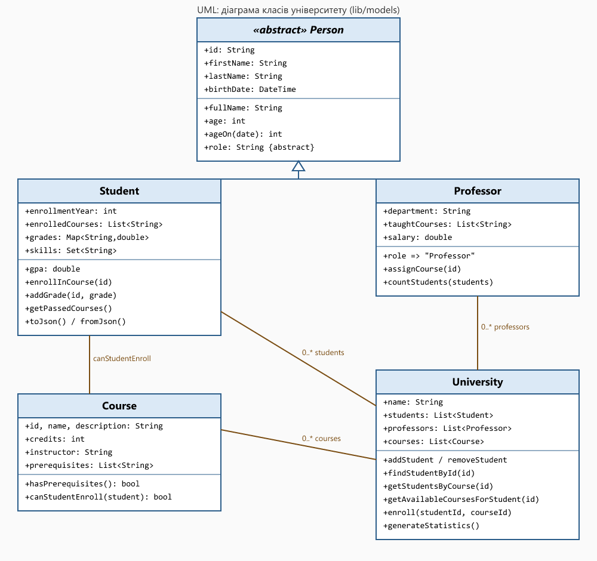
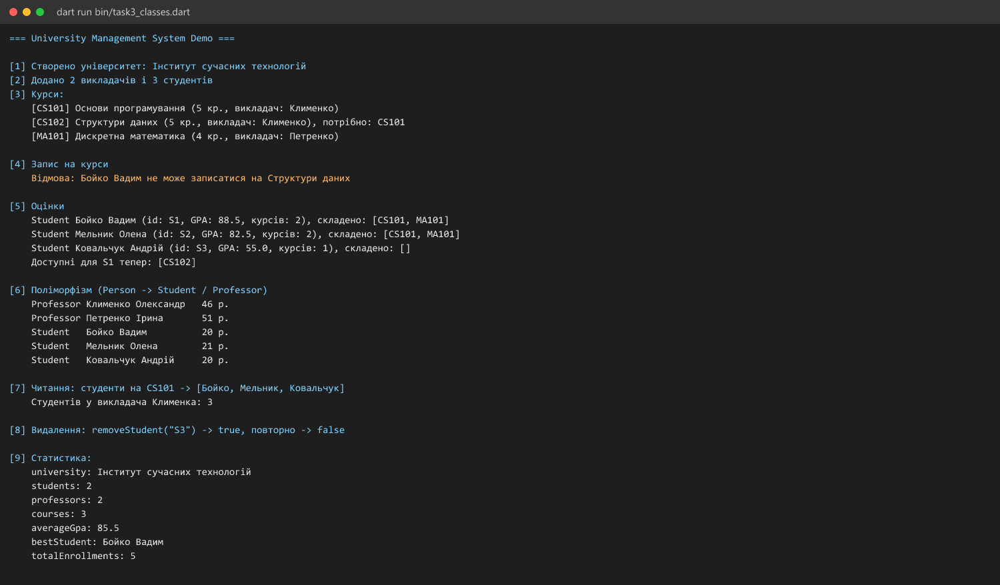
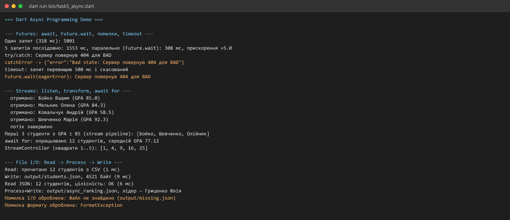

# Практична робота 4. Основи мови Dart

**Дисципліна:** Програмування для мобільних платформ
**Студент:** Бойко Вадим, група АЛК-43
**Репозиторій:** https://github.com/vboyko-ux/dart-basics-boyko

Система управління університетом на Dart: класи й спадкування, обробка колекцій, функціональне програмування, асинхронне читання й запис файлів. Усе покрито тестами, є бенчмарки та звіт про покриття.

## Що зроблено (за завданнями ТЗ)

| № | Завдання | Де | Результат |
|---|---|---|---|
| 1 | Проєкт, структура, README, `.gitignore` | `pubspec.yaml`, уся структура | `dart analyze`: No issues found |
| 2 | Змінні, типи, функції; калькулятор і текстовий аналізатор | `bin/task1_variables.dart`, `bin/task2_functions.dart`, `bin/calculator_app.dart`, `bin/text_analyzer_app.dart`, `lib/utils/calculator.dart`, `lib/utils/text_analyzer.dart` | усі типи Dart, named/optional параметри, замикання, рекурсія |
| 3 | ООП: класи, спадкування, поліморфізм, CRUD | `lib/models/*`, `bin/task3_classes.dart` | `Person` → `Student`, `Professor`; `University` з CRUD |
| 4 | Колекції та обробка даних (CSV → звіти) | `lib/utils/data_processor.dart`, `bin/task4_collections.dart`, `data/students.csv` | звіти `output/report.txt`, `report.json`, `students_ranked.csv` |
| 5 | Async: Future, Stream, JSON-файли, порівняння швидкості | `lib/utils/async_service.dart`, `bin/task5_async.dart` | паралельні запити в ~4–5 разів швидші за послідовні |
| DEL-3 | UML-діаграма | `docs/uml.png`, `docs/uml.svg` | див. нижче |
| DEL-5 | Тести, покриття, бенчмарки | `test/`, `docs/coverage.md`, `docs/benchmarks.md` | 51 тест, покриття 96,1 % |

## Структура проєкту

```text
dart_basics_boyko/
├── README.md
├── pubspec.yaml
├── analysis_options.yaml
├── bin/
│   ├── task1_variables.dart      # типи, рядки, булева логіка, колекції, null safety
│   ├── task2_functions.dart      # функції, замикання, рекурсія
│   ├── task3_classes.dart        # демо системи університету
│   ├── task4_collections.dart    # аналіз CSV, групування, звіти
│   ├── task5_async.dart          # Future, Stream, файлові операції
│   ├── calculator_app.dart       # консольний калькулятор
│   ├── text_analyzer_app.dart    # текстовий аналізатор
│   └── benchmark.dart            # вимірювання продуктивності
├── lib/
│   ├── dart_basics_boyko.dart    # єдина точка імпорту
│   ├── models/  person.dart, student.dart, course.dart, university.dart
│   └── utils/   calculator.dart, text_analyzer.dart, data_processor.dart, async_service.dart
├── test/        models_test.dart, utils_test.dart, async_test.dart
├── data/        students.csv, sample_text.txt
├── output/      звіти та JSON, які створюють програми
├── docs/        скриншоти (shots/), UML, покриття, бенчмарки
└── tools/       допоміжні скрипти (знімки консолі, UML, підсумок покриття)
```

`Person` винесено в окремий файл `lib/models/person.dart`, а `university.dart` його реекспортує: так `Student` і `Professor` успадковують `Person` без циклічного імпорту.

## Встановлення Dart SDK

Потрібен Dart SDK 3.0.0 або новіший (перевірено на 3.13.7).

1. Windows: `winget install Google.DartSDK`, або через Chocolatey `choco install dart-sdk`. Dart також входить до складу Flutter SDK (`flutter/bin/dart`).
2. Інші системи: https://dart.dev/get-dart
3. Перевірка: `dart --version`

## Запуск

```bash
dart pub get                           # залежності

dart run bin/task1_variables.dart      # Завдання 2.1: типи даних
dart run bin/task2_functions.dart      # Завдання 2.2: функції
dart run bin/calculator_app.dart "12 + 3.5"   # калькулятор (без аргументів — демо)
dart run bin/text_analyzer_app.dart data/sample_text.txt
dart run bin/task3_classes.dart        # Завдання 3: університет
dart run bin/task4_collections.dart    # Завдання 4: CSV → звіти в output/
dart run bin/task5_async.dart          # Завдання 5: async і файли
dart run bin/benchmark.dart            # бенчмарки → docs/benchmarks.md

dart analyze                           # статичний аналіз
dart format .                          # форматування
dart test                              # 51 тест
dart test --coverage=coverage          # покриття
dart run coverage:format_coverage --lcov --in=coverage --out=coverage/lcov.info --report-on=lib
node tools/coverage_summary.js         # підсумок у docs/coverage.md
```

Усі команди запускати з каталогу проєкту (програми читають `data/` і пишуть у `output/` відносно нього).

## Приклади використання класів

```dart
import 'package:dart_basics_boyko/dart_basics_boyko.dart';

final uni = University(name: 'Інститут сучасних технологій');
uni.addCourse(Course(id: 'CS101', name: 'Основи програмування',
    description: 'Вступ до Dart', credits: 5, instructor: 'Клименко'));
uni.addCourse(Course(id: 'CS102', name: 'Структури даних',
    description: 'Колекції', credits: 5, instructor: 'Клименко',
    prerequisites: ['CS101']));

uni.addStudent(Student(id: 'S1', firstName: 'Вадим', lastName: 'Бойко',
    birthDate: DateTime(2006, 3, 14)));

uni.enroll('S1', 'CS101');                      // запис з перевіркою передумов
uni.findStudentById('S1')!.addGrade('CS101', 92);
uni.enroll('S1', 'CS102');                      // тепер дозволено: CS101 складено
print(uni.generateStatistics());                // {students: 1, averageGpa: 92.0, ...}

final Person p = Professor(id: 'P1', firstName: 'О', lastName: 'К',
    birthDate: DateTime(1980, 1, 1), department: 'ПІ', salary: 42000);
print(p.role);                                   // Professor (поліморфізм)
```

```dart
print(formatName('Вадим', 'Бойко', middleName: 'Олегович', uppercase: true));
print(DataProcessor.sortStudentsByGPA(students).first['name']);
final data = await fetchAllParallel(['S1', 'S2', 'S3']);   // Future.wait
```

## UML-діаграма класів



## Результати запуску (скриншоти в `docs/shots/`)

Скриншоти зроблено з реального виводу програм (`tools/term_png.js` малює збережений текст виводу командою `dart run …`).

| Програма | Файл |
|---|---|
| Типи даних | `docs/shots/task1_variables_1.png`, `task1_variables_2.png` |
| Функції | `docs/shots/task2_functions.png` |
| Калькулятор | `docs/shots/calculator_app.png` |
| Текстовий аналізатор | `docs/shots/text_analyzer_app.png` |
| Університет (ООП) | `docs/shots/task3_classes.png` |
| Колекції й звіти | `docs/shots/task4_collections_1.png`, `task4_collections_2.png` |
| Async | `docs/shots/task5_async.png` |
| `dart analyze` і `dart test` | `docs/shots/analyze_and_tests.png` |




## Дані та звіти (DEL-4)

- Вхід: `data/students.csv`, 12 студентів, 5 курсів.
- Вихід: `output/report.txt` (таблиця по курсах), `output/report.json` (статистика, курси, рейтинг), `output/students_ranked.csv`, `output/students.json`, `output/async_ranking.json`.
- Приклад із `output/report.txt`: «Основи програмування — записано 12, склали 10, середня 78,75».

## Тести й покриття (DEL-5)

- `dart test`: **51 тест**, усі проходять; `dart analyze`: **No issues found**.
- Покриття рядків у `lib/`: **96,1 %** (299 з 311), таблиця по файлах у `docs/coverage.md`.
- Тести перевіряють і помилкові випадки: ділення на нуль, оцінка поза 0–100, дублікат студента, запис без передумов, відсутній і пошкоджений JSON, `timeout`.

## Бенчмарки

Повна таблиця: `docs/benchmarks.md`. Головні висновки:

| Порівняння | Результат |
|---|---|
| Фібоначчі(30): цикл і рекурсія | 0,38 мкс проти ≈ 4 970 мкс |
| `Set.contains` проти `List.contains` (×1000, 20 000 елементів) | ≈ 112 мкс проти ≈ 8 400 мкс |
| 5 запитів по 100 мс: послідовно проти `Future.wait` | ≈ 556 мс проти ≈ 119 мс |

Висновок: для частих пошуків краще `Set`, незалежні асинхронні запити варто запускати паралельно, а рекурсію без мемоізації не слід застосовувати для великих `n`.

## Труднощі та рішення

1. **Циклічний імпорт.** За ТЗ `Person` був у `university.dart`, а `Student` в окремому файлі й мав його успадковувати. Рішення: `Person` винесено в `person.dart`, `university.dart` його реекспортує.
2. **Факторіал переповнює `int`.** Вже `factorial(21)` не вміщується в 64 біти. Рішення: для `n > 20` кидається `ArgumentError`, перевірено тестом.
3. **Рекурсивні Фібоначчі повільні.** Базова функція зроблена ітеративною; рекурсивний варіант залишено для порівняння в бенчмарку й тестів.
4. **Попередження аналізатора в демо null safety.** Змінна `String? nickname;` одразу ставала відомо-`null`, і аналізатор позначав порівняння як зайве. Рішення: значення береться з функції `_findNickname()`, тому демонстрація `??`, `?.`, `??=` залишилась коректною.
5. **Дублікати в літералі множини.** `{1, 2, 3, 3, 2}` аналізатор відхиляє, тому множина будується із списку через spread: `<int>{...[1, 2, 3, 3, 2]}`.
6. **Дані вхідного CSV.** Розбір не вміє лапки й коми всередині полів, тому списки (`skills`, `courses`, `grades`) у файлі розділені крапкою з комою; некоректні рядки дають `FormatException` з текстом рядка.
7. **Шкала GPA.** У ТЗ поріг складання 60, тому `gpa` у цій роботі це середній бал за 100-бальною шкалою, а не за 4-бальною.
##9. Використання інструментів ШІ

Назва інструменту: Claude (Anthropic), ШІ-асистент.

Мета використання: допомога у форматуванні тексту звіту, генерації UML-діаграми (PlantUML) та створенні скриптів для конвертації виводу консолі в зображення.

Текстові запити: «Створи PlantUML код для класів Person, Student, Professor, University та Course за моїм описом», «Напиши скрипт на Node.js для запуску команди dart run та збереження її виводу у форматі PNG».

Що увійшло до роботи: згенерований код PlantUML для UML-діаграми класів, скрипти (tools/term_png.js) для створення скриншотів, стилістично відредагований текст файлів README.md та coverage.md. Увесь програмний код мовою Dart, структура проєкту, бенчмарки та тести були написані мною повністю самостійно.

Власне доопрацювання: згенерований код PlantUML був адаптований для коректного відображення зв'язків між класами, скрипти для знімків консолі були протестовані та налаштовані під конкретні команди. Логіка роботи системи, покриття тестами та аналіз результатів бенчмарків були реалізовані та описані без використання ШІ.

## Допущення

- Прізвище в назвах: `dart_basics_boyko` (проєкт) і `dart-basics-boyko` (репозиторій).
- Усі дані в `data/students.csv` (імена, дати, оцінки) вигадані для демонстрації.
- Мінімум 15 комітів у історії виконано (див. `git log`).
